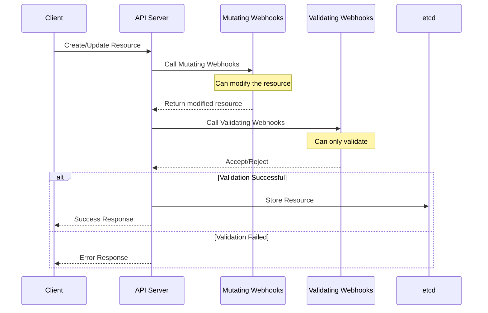

# Webhooks

Webhooks in Kubernetes allow you to intercept and modify requests to the API server. KubeOps supports three types of webhooks:

- Validation Webhooks: Validate resources before they are created or updated
- Mutation Webhooks: Modify resources before they are stored
- Conversion Webhooks: Convert between different versions of your custom resources

:::warning[Web Version Required]
Webhooks require the web version of KubeOps (`KubeOps.Operator.Web`) as they need to expose HTTP endpoints. This introduces additional dependencies on ASP.NET Core.
:::

## Webhook Flow

When a request comes to the Kubernetes API server, it goes through several admission controllers. Here's how webhooks fit into this flow:



The sequence shows that:

1. Mutation webhooks run first and can modify the resource
2. Validation webhooks run after mutations and can only validate
3. The resource is only stored if all validations pass

## Local Development Considerations

The Kubernetes API server calls webhooks over HTTPS. When the operator runs on your machine, the API server must be able to reach it. Which option fits depends on whether it can reach your machine directly:

| Situation | Option | Method |
| --- | --- | --- |
| The API server reaches your machine directly (kind, Docker Desktop, minikube, a cluster in the same network) | Certificate provider: the operator serves HTTPS itself with a generated certificate | `UseCertificateProvider` |
| The API server cannot reach your machine (cloud cluster, NAT, VPN) | Tunnel: a tunnel service exposes a public HTTPS URL and forwards to the operator | `UseExternalWebhookEndpoint` |
| The operator runs in an Aspire AppHost | Aspire starts a Microsoft Dev Tunnel and passes its URL to the operator | `WithWebhookDevTunnel` |

All options register the `dev-validators` and `dev-mutators` webhook configurations (and the conversion webhook of each CRD) when the operator starts, pointing to the chosen URL.

### Certificate provider

`UseCertificateProvider` serves the webhooks via HTTPS with a certificate from an `ICertificateProvider`. `CertificateGenerator` creates a self-signed CA and a server certificate for the given IP address or host name; the CA is registered as `caBundle`, so the API server trusts the certificate.

```csharp
#if DEBUG
const string ip = "192.168.1.100"; // an address of your machine that the API server can reach
const ushort port = 443;
using var generator = new CertificateGenerator(ip);
var cert = generator.Server.CopyServerCertWithPrivateKey();

builder.WebHost.ConfigureKestrel(o => o.Listen(IPAddress.Any, port, l => l.UseHttps(cert)));

builder.Services
    .AddKubernetesOperator()
    .UseCertificateProvider(port, ip, generator)
    .RegisterComponents();
#endif
```

:::note[Clusters in containers]
With kind, Docker Desktop or minikube, the API server runs inside a container or VM, so `localhost` is not your machine. Use an address of your machine that is reachable from there, for example its LAN IP or the gateway of the container network.
:::

### Tunnel

`UseExternalWebhookEndpoint` registers the webhooks against the public HTTPS URL of a tunnel that forwards to the operator. The tunnel terminates TLS with a publicly trusted certificate, so the operator listens on plain HTTP and no `caBundle` is needed. The SDK does not start the tunnel; use the CLI of a maintained tunnel service.

```csharp
#if DEBUG
builder.Services
    .AddKubernetesOperator()
    .UseExternalWebhookEndpoint(new Uri("https://my-tunnel-5000.euw.devtunnels.ms"))
    .RegisterComponents();
#endif
```

To keep the URL out of the code, call `UseExternalWebhookEndpoint()` without arguments. It reads the URL from the configuration key `KubeOps:Webhooks:ExternalUrl` (environment variable `KubeOps__Webhooks__ExternalUrl`, e.g. in `launchSettings.json` or `appsettings.Development.json`) and fails the start if the value is missing. If your endpoint uses a certificate that is not publicly trusted, pass its CA as `caBundle`: `UseExternalWebhookEndpoint(uri, caBundle)`.

If the URL contains a path, the webhook routes are appended to it: `https://proxy.example.com/my-operator` registers `https://proxy.example.com/my-operator/validate/v1demoentity`. The operator serves the routes at the root, so the proxy must strip the path prefix before it forwards a request.

The following examples forward to an operator listening on `http://localhost:5000`. A persistent URL saves you from updating the configuration on every run.

**Microsoft Dev Tunnels**

```bash
devtunnel user login                      # once; Microsoft or GitHub account (-g)

# once: create a persistent tunnel with a stable URL
devtunnel create kubeops-dev --allow-anonymous
devtunnel port create kubeops-dev -p 5000 --protocol http

# every session
devtunnel host kubeops-dev
# → https://<tunnel-id>-5000.<region>.devtunnels.ms
```

For a one-off session without a persistent tunnel, run `devtunnel host -p 5000 --allow-anonymous`; the URL changes on every start.

**Cloudflare Tunnel**

```bash
cloudflared tunnel --url http://localhost:5000
# → https://<random>.trycloudflare.com
```

Quick tunnels need no account, but the URL changes on every start. A stable URL requires a named tunnel with a Cloudflare account and your own domain.

**ngrok**

```bash
ngrok config add-authtoken <token>               # once; account required
ngrok http 5000 --url=<name>.ngrok-free.app      # free static domain
```

### Aspire

When the operator runs in an Aspire AppHost, `WithWebhookDevTunnel` from `KubeOps.Aspire.Hosting` starts a Microsoft Dev Tunnel for the operator's `http` endpoint and passes its URL to the operator as `KubeOps__Webhooks__ExternalUrl`. The operator starts once the tunnel is running.

```csharp
// AppHost
builder.AddKubeOps<Projects.WebhookOperator>("operator")
    .RunWithKubernetes(k8s)
    .WithWebhookDevTunnel();

// Operator
builder.Services
    .AddKubernetesOperator()
    .UseExternalWebhookEndpoint()
    .RegisterComponents();
```

The `devtunnel` CLI must be installed; Aspire asks you to sign in when needed. The tunnel ID is derived from the resource name and the AppHost, so the URL stays the same across runs. Pass another endpoint name or configure the tunnel with the optional parameters, e.g. `WithWebhookDevTunnel("webhooks", tunnel => tunnel.WithExpiration(24))`. In publish mode, `WithWebhookDevTunnel` adds nothing.

### Security and shared clusters

- **Anonymous public endpoint**: The API server cannot authenticate against a tunnel service, so the tunnel must allow anonymous access. Anyone who knows the URL can send requests to your webhooks while the tunnel runs. Your organization's policy may restrict anonymous tunnels.
- **Webhook configurations are cluster-wide**: The registered webhooks intercept the requests of everyone who changes the resource type in that cluster, not only your own. On a shared cluster, use a dedicated CRD group or restrict the webhooks with a `NamespaceSelector` via a [custom webhook configuration factory](../configuration/generation-customization#customizing-webhook-configuration-generation).
- **Stopped operator**: The configurations remain after the operator stops. With `FailurePolicy: Fail`, every create or update of the resource is rejected until the operator runs again. Remove them when you are done: `kubectl delete validatingwebhookconfiguration dev-validators` and `kubectl delete mutatingwebhookconfiguration dev-mutators`.
- **Cloud clusters**: The API server calls the tunnel from the control plane. If its outbound traffic is routed through your network (for example with API server VNet integration on AKS), the tunnel domain must be allowed there. The tunnel client on your machine needs outbound HTTPS to the tunnel service.

:::info[Migration from `AddDevelopmentTunnel`]
`AddDevelopmentTunnel` and the LocalTunnel dependency have been removed. Start a tunnel as shown above and replace `AddDevelopmentTunnel(port)` with `UseExternalWebhookEndpoint(...)`, or use `WithWebhookDevTunnel` in an Aspire AppHost.
:::

## Endpoint Routing

KubeOps automatically registers an HTTP route for each webhook. The route is determined by the
attribute applied to the webhook class — specifically by the **entity type** passed to that attribute.

| Webhook Type | Attribute | Route Pattern |
|---|---|---|
| Validation | `[ValidationWebhook(typeof(TEntity))]` | `/validate/{entity-type-name}` |
| Mutation | `[MutationWebhook(typeof(TEntity))]` | `/mutate/{entity-type-name}` |
| Conversion | `[ConversionWebhook(typeof(TEntity))]` | `/convert/{group}/{plural-name}` |

### How the route segments are derived

For **validation** and **mutation** webhooks, `{entity-type-name}` is the C# type name of
the entity converted to lowercase. It is computed as:

```
entityType.Name.ToLowerInvariant()
```

This means the route segment reflects the **entity type**, not the webhook class name.

For example, a webhook declared as:

```csharp
[ValidationWebhook(typeof(V1DemoEntity))]
public class DemoValidationWebhook : ValidationWebhook<V1DemoEntity> { /* ... */ }
```

registers the route `/validate/v1demoentity` — derived from `V1DemoEntity`, not from `DemoValidationWebhook`.

| Entity type | Validation route | Mutation route |
|---|---|---|
| `V1DemoEntity` | `/validate/v1demoentity` | `/mutate/v1demoentity` |
| `V1TestEntity` | `/validate/v1testentity` | `/mutate/v1testentity` |
| `MyCustomResource` | `/validate/mycustomresource` | `/mutate/mycustomresource` |

For **conversion** webhooks, the route uses the entity's Kubernetes metadata instead:

- `{group}` — the API group from the `[KubernetesEntity]` attribute (e.g., `webhook.dev`)
- `{plural-name}` — the plural resource name from the CRD metadata (e.g., `testentities`)

A conversion webhook for an entity annotated with
`[KubernetesEntity(Group = "webhook.dev", ApiVersion = "v2", Kind = "TestEntity")]`
registers the route `/convert/webhook.dev/testentities`.

### Webhook classes

A webhook class may derive from its webhook base class directly or through an intermediate class of your own,
for example an abstract generic base that adds logging. Abstract classes are not registered.

Each entity kind, group and version can have only one validation and one mutation webhook, because the webhook
names in the API server are derived from the entity. With a second one the operator fails to start and names the
duplicate webhook.

## Validation Webhooks

Validation webhooks allow you to enforce custom validation rules for your resources. They are called before a resource is created or updated.

```csharp
[ValidationWebhook(typeof(V1DemoEntity))]
public class DemoValidationWebhook : ValidationWebhook<V1DemoEntity>
{
    public override ValidationResult Create(V1DemoEntity entity, bool dryRun)
    {
        if (entity.Spec.Username == "forbidden")
        {
            return Fail("Username may not be 'forbidden'.", 422);
        }

        return Success();
    }

    public override ValidationResult Update(
        V1DemoEntity oldEntity,
        V1DemoEntity newEntity,
        bool dryRun)
    {
        if (newEntity.Spec.Username == "forbidden")
        {
            return Fail("Username may not be 'forbidden'.");
        }

        return Success();
    }
}
```

## Mutation Webhooks

Mutation webhooks allow you to modify resources before they are stored. They are called before validation webhooks.

```csharp
[MutationWebhook(typeof(V1DemoEntity))]
public class DemoMutationWebhook : MutationWebhook<V1DemoEntity>
{
    public override MutationResult<V1DemoEntity> Create(
        V1DemoEntity entity,
        bool dryRun)
    {
        if (entity.Spec.Username == "overwrite")
        {
            entity.Spec.Username = "random overwritten";
            return Modified(entity);
        }

        return NoChanges();
    }
}
```

## Conversion Webhooks

:::warning[Preview Feature]
Conversion webhooks are currently in preview. The API is not stable and may change in future versions.
:::

To enable preview features, add the following to your project file:

```xml title="MyOperator.csproj"
<PropertyGroup>
    <EnablePreviewFeatures>true</EnablePreviewFeatures>
</PropertyGroup>
```

### Understanding Conversion Webhooks

Conversion webhooks are used to convert between different versions of your custom resources. They are essential when:

- You have multiple versions of your CRD
- You need to maintain backward compatibility
- You want to evolve your API without breaking existing clients

The storage version is the version that Kubernetes uses to store your resources. All other versions must be able to convert to and from the storage version.

### Implementing Conversion Webhooks

```csharp
[ConversionWebhook(typeof(V3DemoEntity))]
public class DemoConversionWebhook : ConversionWebhook<V3DemoEntity>
{
    protected override IEnumerable<IEntityConverter<V3DemoEntity>> Converters =>
        new IEntityConverter<V3DemoEntity>[]
        {
            new V1ToV3(),
            new V2ToV3(),
        };

    private class V1ToV3 : IEntityConverter<V1DemoEntity, V3DemoEntity>
    {
        public V3DemoEntity Convert(V1DemoEntity from)
        {
            var nameSplit = from.Spec.Name.Split(' ');
            var result = new V3DemoEntity { Metadata = from.Metadata };
            result.Spec.Firstname = nameSplit[0];
            result.Spec.Lastname = string.Join(' ', nameSplit[1..]);
            return result;
        }

        public V1DemoEntity Revert(V3DemoEntity to)
        {
            var result = new V1DemoEntity { Metadata = to.Metadata };
            result.Spec.Name = $"{to.Spec.Firstname} {to.Spec.Lastname}";
            return result;
        }
    }

    private class V2ToV3 : IEntityConverter<V2DemoEntity, V3DemoEntity>
    {
        public V3DemoEntity Convert(V2DemoEntity from)
        {
            var result = new V3DemoEntity { Metadata = from.Metadata };
            result.Spec.Firstname = from.Spec.Firstname;
            result.Spec.Lastname = from.Spec.Lastname;
            return result;
        }

        public V2DemoEntity Revert(V3DemoEntity to)
        {
            var result = new V2DemoEntity { Metadata = to.Metadata };
            result.Spec.Firstname = to.Spec.Firstname;
            result.Spec.Lastname = to.Spec.Lastname;
            return result;
        }
    }
}
```

### Important Considerations for Conversion Webhooks

1. **Complete Conversion Path**:

   - All versions must be able to convert to and from the storage version
   - Missing conversions will cause errors when accessing resources

2. **Data Loss**:

   - Be careful when converting between versions
   - Some data might be lost when converting back and forth
   - Consider adding validation to prevent data loss

3. **Storage Version**:

   - Choose a stable version as your storage version
   - The storage version should be able to represent all data from other versions
   - Use the `[StorageVersion]` attribute to mark the storage version

4. **Testing**:
   - Test conversions in both directions
   - Verify that no data is lost
   - Test with real-world data scenarios

## Best Practices

1. **Validation Webhooks**:

   - Webhooks sit in the **write path of the API server** and run under a strict timeout
     (10 seconds by default, 30 at most): validate only from the request payload and avoid calls
     to external systems — a slow validator delays or fails every create/update of that resource
   - Return error messages that tell the user *which field* is wrong and *what a valid value
     looks like* — the message surfaces directly in `kubectl` output
   - Remember validation also runs for `dryRun` requests: it must be side-effect free

2. **Mutation Webhooks**:

   - Mutations must be **idempotent** — the API server may invoke the webhook again on the
     already-mutated object (reinvocation), and applying the mutation twice must yield the same
     result
   - Only set defaults and normalize values; reject invalid input in a validation webhook instead
     of "fixing" it silently
   - The mutated object still passes validation webhooks afterwards — make sure your own
     validator accepts everything your mutator produces

3. **Conversion Webhooks**:

   - Conversions must be **lossless roundtrips**: converting v1 → v2 → v1 has to reproduce the
     original object, otherwise data is destroyed on the next write of an old client
   - Fields that only exist in the newer version need a defined representation in the older one
     (commonly an annotation), or the roundtrip breaks
   - Test conversions with real stored objects of every served version, not just constructed
     samples

4. **Security**:
   - Always serve webhooks over TLS — the API server refuses plain HTTP (see [Local Development Considerations](#local-development-considerations) for certificate options during development)
   - Choose the `FailurePolicy` consciously: `Fail` blocks resource operations when the webhook is down, `Ignore` silently skips it — both can be customized via the [webhook configuration factory](../configuration/generation-customization#customizing-webhook-configuration-generation)
   - Restrict webhooks to the namespaces they need via a `NamespaceSelector` instead of intercepting cluster-wide traffic

## Common Pitfalls

1. **The webhook blocks the whole cluster resource type**: With `FailurePolicy: Fail`, an
   unreachable webhook (operator down, wrong service reference, expired certificate) blocks
   **every** create/update of the resource — including the operator's own writes. Decide
   consciously between `Fail` and `Ignore` (see the
   [Security best practices](#best-practices)).

2. **Webhook intercepts its own operator**: A mutating/validating webhook without a
   `NamespaceSelector` or `objectSelector` also intercepts writes made *by the operator itself*
   during reconciliation — a subtle source of loops and latency.

3. **Conversion changes break stored objects**: Objects are persisted in the **storage version**.
   Changing the storage version or shipping an incomplete conversion path makes existing objects
   unreadable for old clients. Roll out new versions as `served: true` first and only switch
   `storage` after the conversion has proven itself.